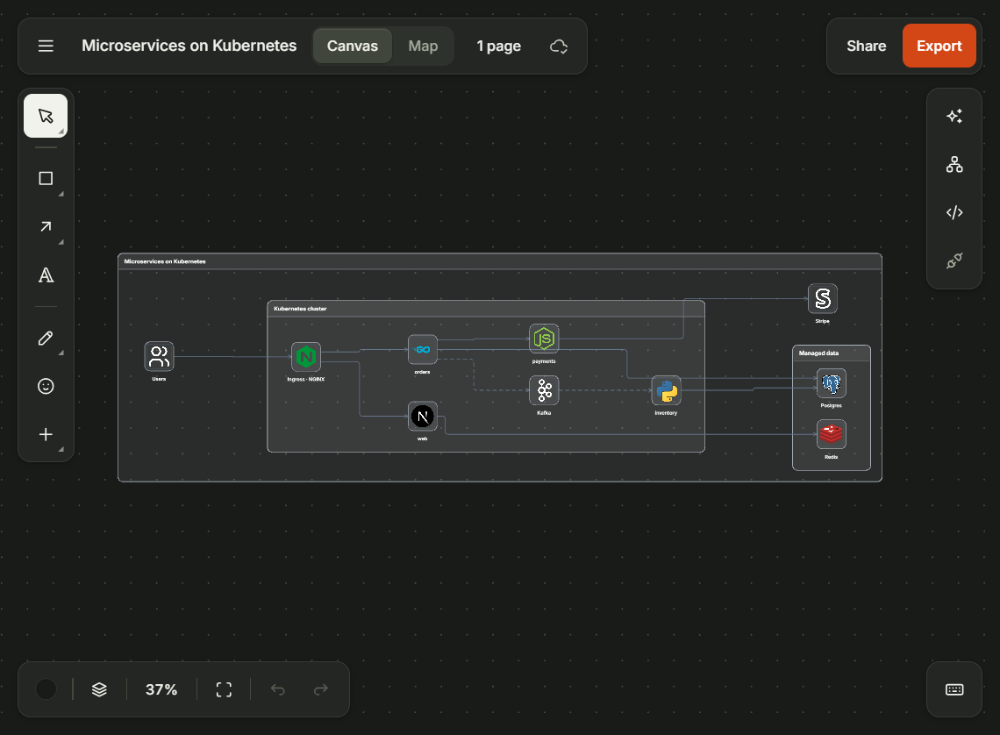
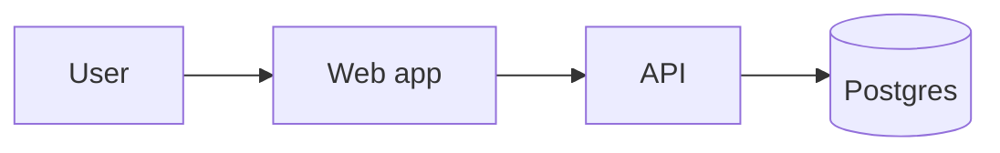
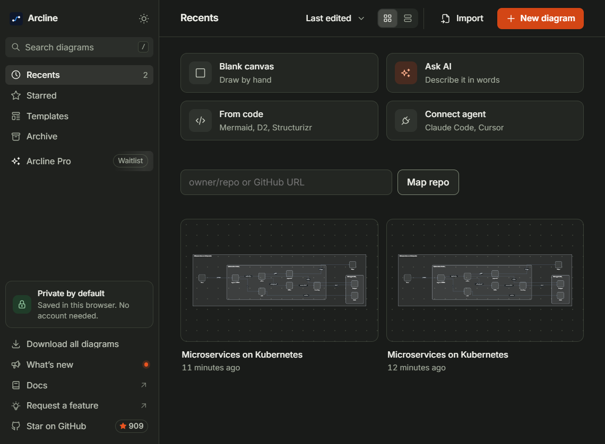
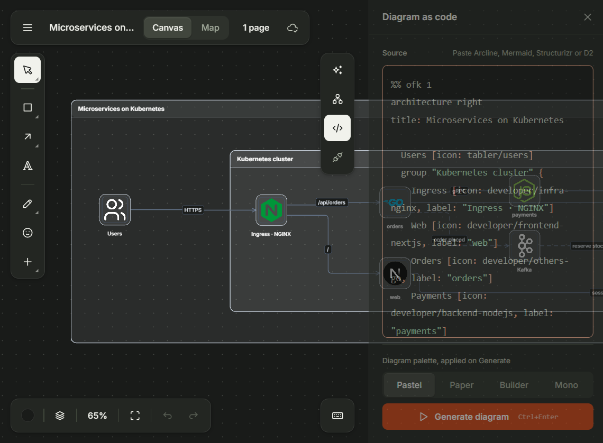
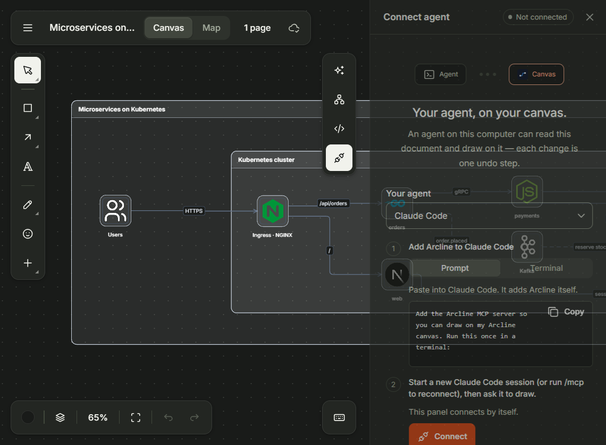
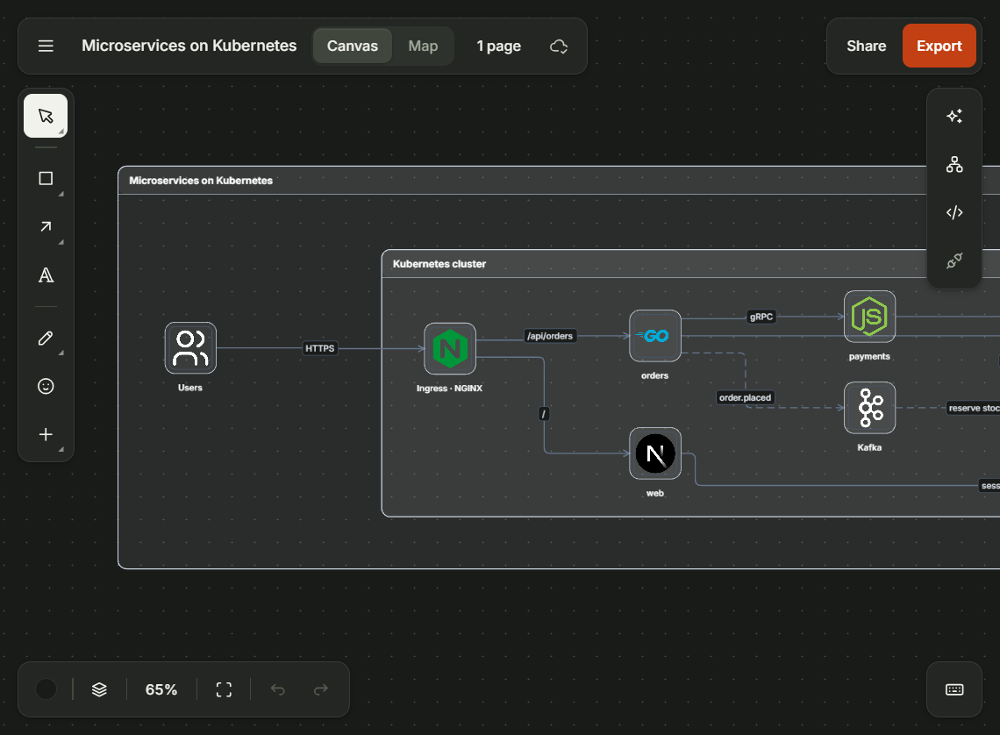

<p align="center">
  
</p>

<h1 align="center">Arcline</h1>

<p align="center">
  <strong>Open-source diagram canvas you and your agent edit together.</strong>
</p>

<p align="center">
  <a href="LICENSE"></a>
  <a href="https://github.com/openflowkit/openflowkit"></a>
  
  
</p>

Arcline is a local-first diagram canvas for architecture, systems, and flows. Draw with the canvas, describe the change in plain words, or write the diagram as code — then connect Claude Code, Cursor, VS Code, or Codex over MCP and let your agent edit the same document.

No account, no cloud: diagrams are saved in your browser. Export when you're done.

> Arcline is an independently maintained fork of [OpenFlowKit](https://github.com/openflowkit/openflowkit) (MIT, Copyright (c) 2026 Varun). The core engine is upstream and unmodified; this fork adds distinct branding, documentation, and maintenance.

## Three ways to work

| Draw | Describe | Code |
| --- | --- | --- |
| Shapes, connectors, groups, text, icons, pages, and Map mode on an infinite canvas. | Ask the built-in assistant, or hand the document to your coding agent. | Write OpenFlow DSL, or paste Mermaid, D2, or Structurizr and generate the diagram. |

## What you get

- **A real canvas** — infinite canvas with shapes, connectors, groups, text, icons, pages, and Map mode for large systems.
- **Diagram as code** — OpenFlow DSL plus Mermaid, D2, and Structurizr import. Edit the source, generate, and keep working on the canvas.
- **Agent-native** — a local MCP server and a live bridge. Your agent reads and draws on the same document; every change is one undo step.
- **Local-first** — diagrams live in IndexedDB in your browser. No account required. Optional encrypted share links use the upstream service.
- **Export and share** — export your diagrams or send a share link when you need a second pair of eyes.
- **CLI for CI** — render, validate, convert, discover, map, and drift-check diagrams from a terminal or a pull request.
- **Your AI, your key** — Anthropic, OpenAI, Google, or a local Ollama model.

## Quick start

Requires **Node.js 22.22 or newer**.

```bash
npm install
npm run dev
```

Open `http://localhost:5173`.

Production build:

```bash
npm run build
npm run preview
```

| Command | What it does |
| --- | --- |
| `npm run dev` | Start the Vite dev server |
| `npm run build` | Typecheck and build for production |
| `npm test` | Run unit tests |
| `npm run e2e` | Run Playwright end-to-end tests |
| `npm run verify` | Full gate: typecheck, lint, unit, MCP tests, headed `@gate` browser set |
| `npm run lint` | Run ESLint |

## Diagram as code

Open the **Diagram as code** panel in the editor (`</>` in the right rail). Paste Mermaid, D2, Structurizr, or OpenFlow DSL and choose **Generate diagram**.



The repo's own C4 model, in the native OpenFlow DSL, lives in [`architecture.ofk`](architecture.ofk).

## Your agent, on your canvas

Arcline ships a local MCP server and a live bridge. Connect once, then ask your agent to draw or change the diagram; the work lands on the canvas as a normal undo step.

```bash
npx -y openflowkit mcp
```

Open **Connect agent** in the app (the plug icon) for client-specific setup for Claude Code, Cursor, VS Code, and Codex, or read the [agent guide](https://docs.openflowkit.com/connect-your-agent/).

> The editor is branded Arcline. The underlying CLI and MCP packages keep their upstream names (`openflowkit`, `openflowkit-mcp`) so existing installs, configs, and workflows keep working.

## CLI

```bash
npx openflowkit render flow.mmd -o flow.svg
npx openflowkit convert flow.mmd -o flow.openflow.json
npx openflowkit validate architecture.ofk
npx openflowkit map . --html map.html
npx -y openflowkit mcp
```

## Screenshots

Dark theme shown. Light theme is included in the app.

| Home | Diagram as code |
| --- | --- |
|  |  |
| **Connect your agent** | **Share and export** |
|  |  |

## Repository layout

| Path | What it is |
| --- | --- |
| `src/` | React + PixiJS editor, domain logic, and DSL |
| `cli/` | The `openflowkit` CLI: render, validate, convert, map, and MCP |
| `mcp-server/` | Local MCP server and live bridge |
| `docs-site/` | Astro documentation site |
| `e2e/` | Playwright end-to-end tests |
| `action/` | GitHub Action that renders changed diagrams in pull requests |
| `assets/` | Brand and README assets |
| `architecture.ofk` | The repo's own C4 model |

## Contributing

Read [CONTRIBUTING.md](CONTRIBUTING.md), then open an issue to propose a change. For the build and test contract, see [AGENTS.md](AGENTS.md); for the system overview, see [ARCHITECTURE.md](ARCHITECTURE.md). Report security issues through [SECURITY.md](SECURITY.md).

Third-party icon sets are credited in the `SOURCE.md` files under `assets/third-party-icons/`.

If Arcline is useful, star the repo — it helps other people find it.

## Fork and license

Arcline is an independently maintained fork of [OpenFlowKit](https://github.com/openflowkit/openflowkit) (MIT, Copyright (c) 2026 Varun). The core engine is upstream and unmodified; this repository adds distinct branding, documentation, and maintenance.

MIT — includes the original OpenFlowKit copyright notice. See [LICENSE](LICENSE).

Copyright (c) 2026 Varun · Copyright (c) 2026 Mohit

---

<p align="center"><sub>Built on OpenFlowKit. Branded and maintained as Arcline.</sub></p>
